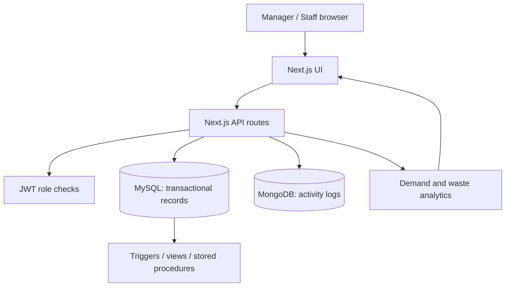

# System architecture

MySQL is the system of record for ingredients, batch stock, suppliers, orders, recipes, purchase orders, waste and alerts. MongoDB stores append-only operational events with flexible event-specific details.
